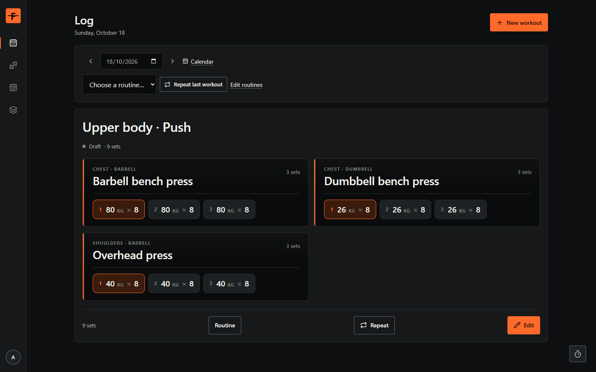
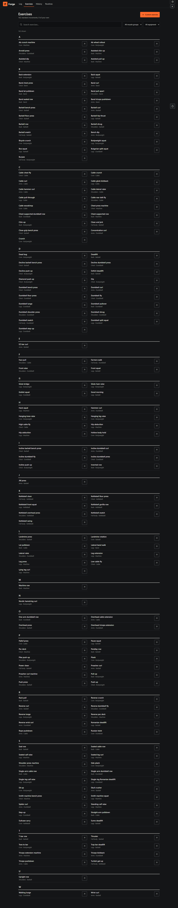
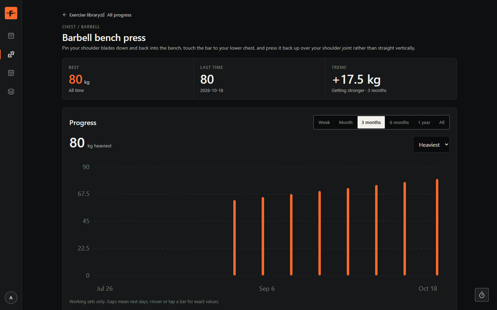
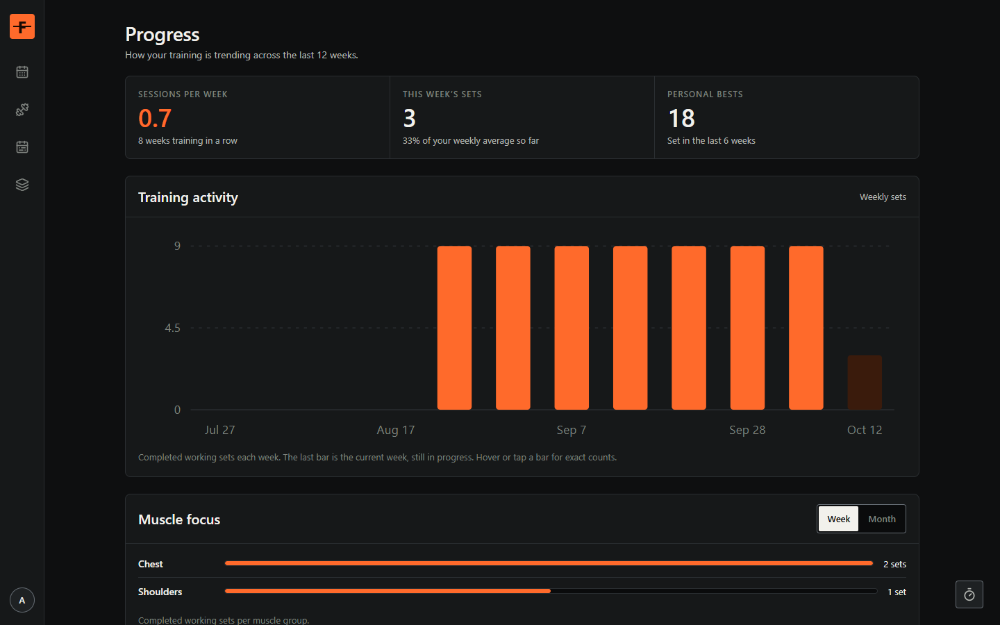
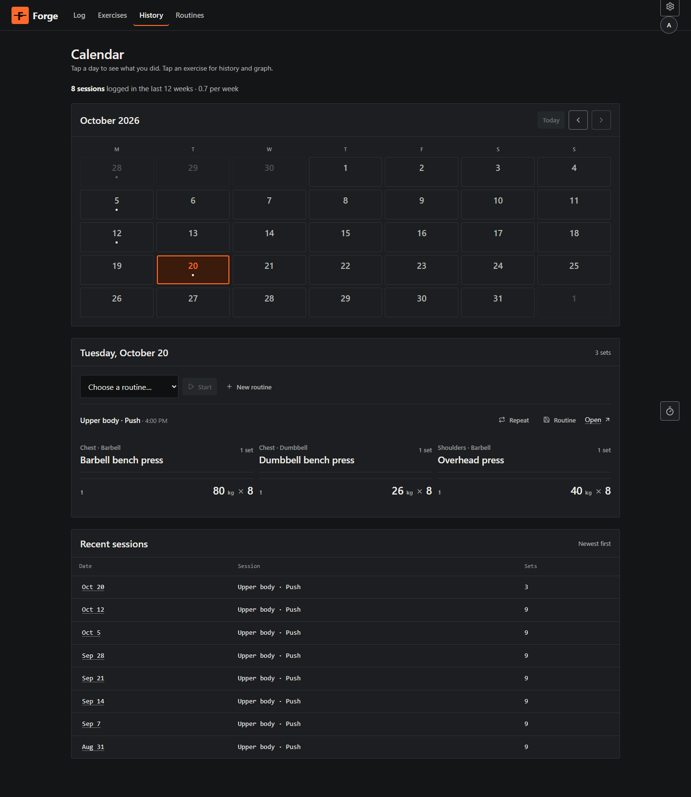
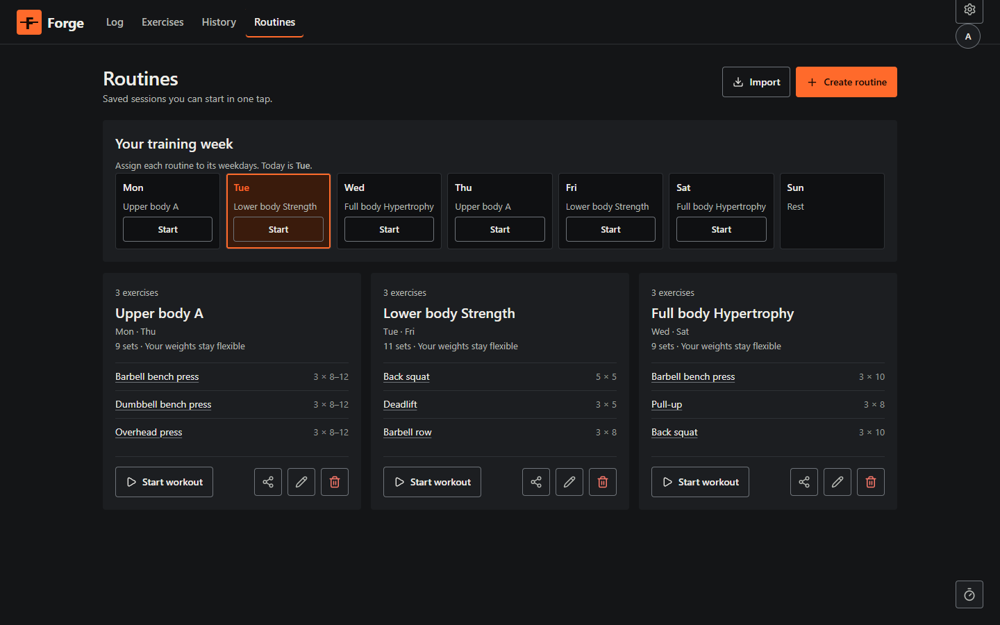
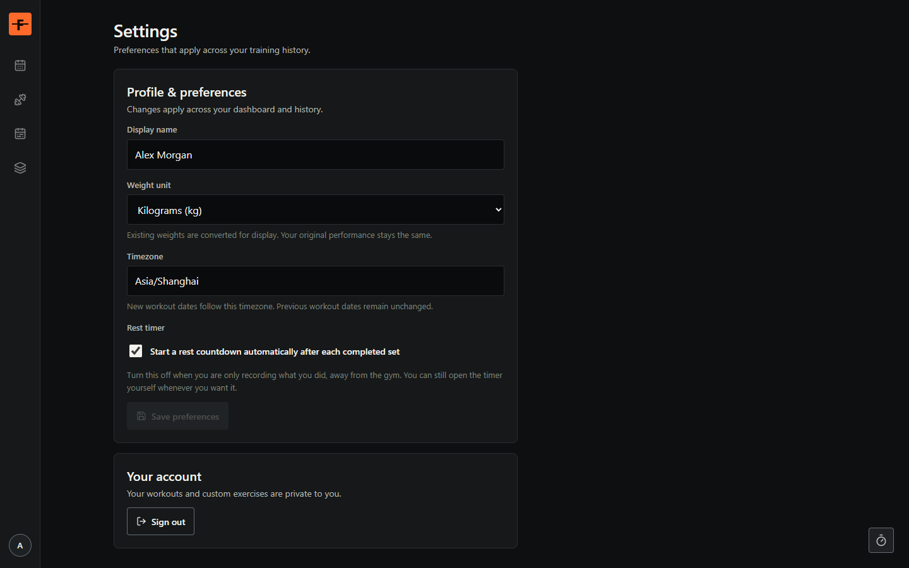

# Forge

Private strength training with Next.js, React, Tailwind CSS, and Supabase PostgreSQL. Log workouts set by set or in one tap, track personal bests, and watch volume, streaks, and muscle balance trend over time.

## Screenshots

Screenshots show seeded demo data served by the isolated UI test harness (`npm run test:server`), so every screen below renders without a Supabase project.

| Exercise library — 162 standard movements plus your own | Exercise history — best, last session, and trend charts |
| --- | --- |
|  |  |

| Progress — weekly volume, streaks, and muscle focus | Calendar — training days, streaks, and repeats |
| --- | --- |
|  |  |

| Routines — reusable templates on a weekly schedule | Settings — profile, units, rest timer, and plates |
| --- | --- |
|  |  |

## Features

- Guided set-by-set logging with rest timers, plus quick entry that saves a whole session in one request (including a plain-text mode such as `60 kg x 8`)
- Double-progression targets, all-time bests, and Epley estimated one-rep max on eligible sets
- 162 seeded standard exercises with coaching cues, custom exercise creation, and typo-tolerant search across names, muscles, equipment, and aliases
- Progress dashboard (weekly volume, streaks, muscle balance), per-exercise history with week-to-all-time ranges, and a training calendar with one-tap repeats
- Reusable routine templates with set/rep schemes, weekday scheduling, and shareable links
- kg/lb display units, timezone-aware dates, bar weight and plate inventory preferences
- Private by default: Supabase Auth, per-user row-level security, and no workout history stored in browser storage

## Run locally

Install dependencies with npm install. Copy .env.example to .env.local and enter your Supabase project URL and publishable key. Apply the SQL migrations in supabase/migrations in filename order using the Supabase SQL editor; docs/SETUP.md lists the ones no hosted project has yet and what breaks until they are applied. Run npm run dev and open http://127.0.0.1:3000.

The app displays a configuration screen until Supabase is configured. It never stores workout history in browser storage.

## Account configuration

Enable email/password authentication and email confirmation. Set Site URL to your application origin and allow /auth/callback and /auth/confirm. Set the confirmation email link to the application's /auth/confirm endpoint with token_hash and type query parameters as described in docs/SETUP.md. Configure production SMTP and test recovery delivery.

## Project references

- [Architecture](docs/ARCHITECTURE.md)
- [Development plan](docs/DEVELOPMENT_PLAN.md)
- [Setup and release](docs/SETUP.md)
- [Continuous integration](docs/CI.md)
- [Backlog and feature specs](docs/BACKLOG.md)

## Verification

npm test runs calculations, validation, and PostgreSQL policy/transaction tests with an embedded PostgreSQL engine. npm run typecheck and npm run build validate production source. npm run test:e2e runs the real UI against an isolated PostgreSQL test harness. npm run test:live verifies real authentication and application APIs with a configured Supabase test project and two dedicated test accounts. See docs/SETUP.md. GitHub Actions runs the same chain on every push and pull request (docs/CI.md).
